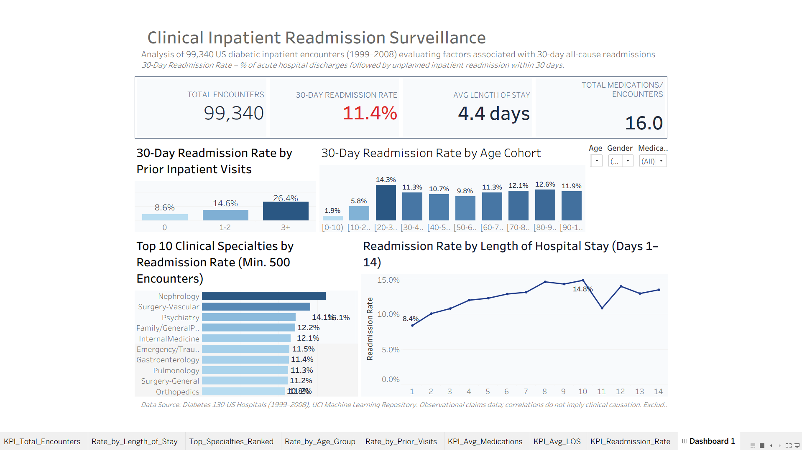

# Hospital 30-Day Readmission Analytics

[](https://www.mysql.com/)
[](https://public.tableau.com/)
[](#)
[](https://archive.ics.uci.edu/dataset/296/diabetes+130-us-hospitals+for+years+1999-2008)

Healthcare data analytics portfolio project analyzing clinical, operational, and demographic factors **associated with 30-day unplanned hospital readmissions** across 130 US hospitals (1999–2008). Built for the **Data Analyst Intern** application at **Innovaccer** (healthcare data, SQL, dashboards).

> **Study Design Note:** All findings, percentages, and metrics reported in this project represent **observational statistical associations** derived from historical administrative claims data. They do not claim, establish, or imply clinical causation.

---

## Interactive Dashboard

[](https://public.tableau.com/)

> **Live Tableau Public Dashboard:**  
> [View Interactive Dashboard on Tableau Public](https://public.tableau.com/views/Hospital-Readmission-Analytics-Innovaccer/Dashboard1) *(Replace with your link after publishing)*

---

## Project Overview

Under the Centers for Medicare & Medicaid Services (CMS) Hospital Readmissions Reduction Program (HRRP), 30-day all-cause readmissions are a critical measure of hospital care quality and patient transition safety.

This project delivers end-to-end healthcare analytics:
1. **Data Ingestion & Hygiene:** Loaded raw clinical claims into MySQL 8.0, audited missingness, and excluded clinically non-viable encounters. Credentials are managed securely via `.env` environment variables.
2. **Clinical Cohort Engineering:** Built `clean_encounters` (99,340 rows) and an un-duplicated patient robustness cohort `first_encounters` (69,987 rows) using SQL window functions (`ROW_NUMBER()`).
3. **Advanced SQL Analytics:** Profiled readmission rates across prior inpatient hospitalizations, clinical specialties (`RANK()` over CTEs), length of stay, glycemic testing (`A1Cresult`), and medication count tiers.
4. **Tableau Public Dashboard:** Designed an executive 1200x800 surveillance dashboard featuring 4 KPIs, linked demographic/specialty filters, and cohort distributions.

---

## Dataset Description & Acquisition

* **Source:** [UCI Machine Learning Repository: Diabetes 130-US Hospitals for Years 1999-2008](https://archive.ics.uci.edu/dataset/296/diabetes+130-us-hospitals+for+years+1999-2008) (Dataset ID 296).
* **Population:** 101,766 inpatient encounters across 71,518 unique patients with diagnosed diabetes mellitus.
* **Key Files:**
  * `diabetic_data.csv`: 50 clinical, demographic, and operational attributes.
  * `IDs_mapping.csv`: ID mapping lookup tables for `admission_type_id`, `discharge_disposition_id`, and `admission_source_id`.

### Data Acquisition Note:
To keep the Git repository lightweight and follow open-data reproducibility standards, the raw dataset files (`data/diabetic_data.csv` and `data/IDs_mapping.csv`) are **excluded from Git tracking via `.gitignore`**. 

To download the raw data:
1. Visit the [UCI Dataset Repository Page](https://archive.ics.uci.edu/dataset/296/diabetes+130-us-hospitals+for+years+1999-2008).
2. Download the dataset zip file and extract `diabetic_data.csv` and `IDs_mapping.csv` into the `data/` folder.
3. The processed Tableau extract (`outputs/tableau_data.csv`) **is included in this repository** (file size: **9.15 MB**, well below the GitHub 25 MB file limit).

---

## Tech Stack & Architecture

* **Relational Database:** MySQL 8.0 (`hospital_analytics`)
* **Analytical SQL:** CTEs, Window Functions (`ROW_NUMBER()`, `RANK()`), Aggregations, Case Logic
* **Data Pipeline & Security:** Python 3.13 (`pymysql`, `pandas`, `python-dotenv` for credential isolation)
* **Business Intelligence / BI:** Tableau Public Desktop (Calculated Fields, Action Filters, KPI Scorecards)
* **Version Control:** Git & GitHub

---

## Repository Structure

```text
hospital-readmission-analytics/
├── .env.example                        # Template for database credentials (no real secrets)
├── .gitignore                          # Ignores .env and raw data files
├── README.md                           # Project documentation, findings, and reproduction guide
├── FINDINGS.md                         # Detailed clinical findings, audit table, and interview Q&A
├── TABLEAU_GUIDE.md                    # Click-by-click Tableau Public dashboard build instructions
├── load_data.py                        # Automated database creation and raw data loader script
├── run_sql.py                          # SQL execution runner utility for local verification
├── run_analysis_and_export.py          # Executes SQL queries, outputs tables, and exports CSVs
├── data/
│   ├── diabetic_data.csv               # Raw dataset from UCI (ignored in git)
│   └── IDs_mapping.csv                 # Lookup mapping tables (ignored in git)
├── sql/
│   ├── 01_profiling.sql                # Data profiling: row counts, missingness, distributions
│   ├── 02_cleaning.sql                 # Cohort cleaning, clinical exclusions, feature engineering
│   ├── 03_validation.sql               # Data pipeline validation and integrity checks
│   └── 04_analysis.sql                 # CTEs, window functions, and clinical risk queries
├── outputs/
│   ├── tableau_data.csv                # Clean dataset exported for Tableau (99,340 rows, 9.15 MB)
│   ├── 01_overall_rate.csv             # Baseline metrics (11.39% readmission rate)
│   ├── 02_rate_by_age.csv              # Readmission rate by 10-year age bracket
│   ├── 03_rate_by_prior_visits.csv     # Readmission rate by prior inpatient hospitalizations
│   ├── 04_rate_by_los.csv              # Readmission rate by length of stay (days 1-14)
│   ├── 05_rate_by_specialty.csv        # Top clinical specialties ranked by readmission rate
│   ├── 06_rate_by_a1c.csv              # Glycemic testing patterns and readmission rate
│   ├── 07_rate_by_medications.csv      # Polypharmacy medication volume tiers
│   ├── 08a_rate_by_gender.csv          # Demographic breakdown by gender
│   ├── 08b_rate_by_race.csv            # Demographic breakdown by race
│   ├── 09a_first_encounters_overall.csv# Robustness check baseline (8.98% readmission rate)
│   ├── 09b_first_encounters_by_age.csv # Robustness check by age
│   └── 09c_first_encounters_by_prior_visits.csv # Robustness check by prior visits
└── dashboard/
    ├── README.md                       # Instructions for adding dashboard screenshot
    └── dashboard_screenshot.png        # Placeholder for your Tableau dashboard screenshot
```

---

## Data Cleaning & Cohort Methodology

All figures reflect verified database outputs:

| Pipeline Stage | Table Name | Total Rows | Unique Patients | Attrition Reason |
| :--- | :--- | :--- | :--- | :--- |
| **Raw Intake** | `raw_encounters` | 101,766 | 71,518 | Baseline dataset |
| **Exclusion 1** | `raw_encounters` | -3 | -3 | Removed `gender = 'Unknown/Invalid'` (unimputable demographic noise) |
| **Exclusion 2** | `raw_encounters` | -2,423 | -1,528 | Removed `discharge_disposition_id IN (11, 13, 14, 19, 20, 21)` (Expired or Hospice) |
| **Clean Cohort** | `clean_encounters` | **99,340** | **69,987** | **Final analytical and Tableau-ready cohort (97.62% retention)** |
| **Robustness Cohort** | `first_encounters` | **69,987** | **69,987** | Deduplicated to each patient's 1st encounter using `ROW_NUMBER()` |

### Key Cleaning Rationale:
* **Hospice & Mortality Exclusion:** Readmission requires being at risk in the community post-discharge. Patients who expired in-hospital (`11, 19, 20`) or transferred to hospice (`13, 14`) cannot be readmitted. Retaining them artificially deflates the readmission rate denominator.
* **Dropping Weight:** Profiled `weight` missingness at **96.86%** (98,569 missing values). Imputation would introduce substantial statistical distortion; dropping it conforms to clinical data science standards.
* **Specialty Imputation:** Missing specialty (`'?'`, 49.08%) was standardized to `'Unknown'` rather than dropped, preserving statistical power while permitting filtering.
* **Missing Race Handling:** In `raw_encounters`, 2,273 rows had `'?'`. In `clean_encounters`, after clinical exclusions (41 rows removed), the remaining 2,232 rows were converted to `NULL` via `CASE WHEN race = '?' THEN NULL ELSE race END`. When exported to `outputs/tableau_data.csv`, `COALESCE(race, 'Unknown')` was applied so Tableau displays an explicit `'Unknown'` category with 0 unmapped nulls.

---

## Key Findings (Verified SQL Outputs)

*All numbers are produced directly from queries executed in MySQL 8.0.*

### 1. Prior Inpatient Hospitalizations Show Strongest Statistical Association
* **0 prior visits:** 8.59% readmission rate (5,690 / 66,242 encounters)
* **1–2 prior visits:** 14.55% readmission rate (3,825 / 26,284 encounters)
* **3+ prior visits:** **26.40% readmission rate** (1,799 / 6,814 encounters)
* *Takeaway:* Patients with 3+ prior hospitalizations had a readmission rate **over 3 times higher** than patients with zero prior admissions.

### 2. High-Risk Specialties: Nephrology Shows Highest Readmission Rate
* Among specialties with >= 500 encounters:
  * **1. Nephrology:** **16.11%** readmission rate (248 / 1,539 encounters; avg LOS 5.04 days)
  * **2. Vascular Surgery:** **14.10%** readmission rate (74 / 525 encounters; avg 20.90 meds)
  * **3. Psychiatry:** **12.19%** readmission rate (104 / 853 encounters; avg LOS 6.40 days)
  * *Comparison:* Cardiology had an **8.03%** readmission rate (424 / 5,278 encounters).
* *Takeaway:* Inpatient encounters under Nephrology and Vascular Surgery were associated with higher readmission rates than general medical specialties.

### 3. Medication Counts & Length of Stay Progression
* **Medication Burden:** Low (1–10 meds) = **9.21%** -> Moderate (11–20 meds) = **11.66%** -> High (21–30 meds) = **13.24%**.
* **Length of Stay:** 1-day stays = **8.39%** -> 8–10 day stays = **14.28% – 14.81%**.
* *Takeaway:* Higher medication volumes and longer hospitalizations are associated with higher readmission rates.

### 4. 83% of Encounters Had No Inpatient HbA1c Recorded
* **83.05% of clean encounters (82,506 / 99,340)** had no HbA1c test recorded in the hospital record (`A1Cresult = 'None'`).
* Untested encounters had an **11.69%** readmission rate, whereas tested encounters exhibited lower rates across all ranges (>7 = **10.15%**, >8 = **9.94%**, Normal = **9.77%**).

### 5. Robustness Check: Repeat Encounters vs Single-Patient Cohort
* The baseline readmission rate across all encounters is **11.39%**. When restricted to each patient's first encounter (`first_encounters`), the rate is **8.98%**.
* In all encounters, the young adult bracket `[20-30)` shows a readmission rate of **14.31%** (1,649 encounters). In first encounters, it is **7.40%** (1,121 encounters). An untested hypothesis is that a small group of repeat utilizers accounted for multiple admissions in this group.
* Crucially, the prior utilization gradient remained steady: 3+ visits yielded a **26.45%** readmission rate vs **8.13%** for 0 visits (**3.25x ratio**).

---

## Limitations

1. **Observational Data:** Findings indicate statistical correlations; **no causal relationships** can be established from observational claims data.
2. **Historical Timeframe (1999–2008):** Predates the ACA Hospital Readmissions Reduction Program (2012) and modern SGLT2 inhibitor / GLP-1 RA therapeutics.
3. **Diabetic Population Specificity:** Restricted to diabetic patients; cannot be generalized across general non-diabetic inpatient populations.
4. **Missing Socioeconomic Context:** Does not capture Social Determinants of Health (SDOH) such as food insecurity, transportation, and health insurance stability.

---

## How to Reproduce

### Prerequisites
* Windows OS with PowerShell
* MySQL 8.0+ running locally (`root` user access)
* Python 3.10+ with `pandas`, `pymysql`, `python-dotenv` (`pip install pandas pymysql python-dotenv`)
* Tableau Public Desktop (free)

### Step 1: Clone Repository
```bash
git clone https://github.com/<your-username>/hospital-readmission-analytics.git
cd hospital-readmission-analytics
```

### Step 2: Configure Environment Variables
Copy the template file `.env.example` to `.env` and set your MySQL password:
```bash
cp .env.example .env
```
Edit `.env`:
```env
DB_HOST=localhost
DB_PORT=3306
DB_USER=root
DB_PASSWORD=your_actual_password
DB_NAME=hospital_analytics
```

### Step 3: Load Data into MySQL
Place `diabetic_data.csv` and `IDs_mapping.csv` into the `data/` directory, then execute:
```bash
python load_data.py
```
*Creates database `hospital_analytics`, lookup tables, and inserts 101,766 rows into `raw_encounters`.*

### Step 4: Run Data Profiling, Cleaning, and Validation
```bash
python run_sql.py sql/01_profiling.sql
python run_sql.py sql/02_cleaning.sql
python run_sql.py sql/03_validation.sql
```

### Step 5: Execute Analytics and Export Outputs
```bash
python run_analysis_and_export.py
```
*Executes all analytical queries, prints tables, and populates `outputs/tableau_data.csv` and individual CSV summaries.*

### Step 6: Build Tableau Public Dashboard
Follow the click-by-click instructions in [TABLEAU_GUIDE.md](file:///c:/Users/DELL/Desktop/Healthcare_project/hospital-readmission-analytics/TABLEAU_GUIDE.md).

---

## Author & Contact

* **Candidate:** B.Tech Computer Science Student
* **Target Role:** Data Analyst Intern at Innovaccer
* **Portfolio Focus:** Healthcare Data Architecture, SQL Engineering, BI Dashboard Design
